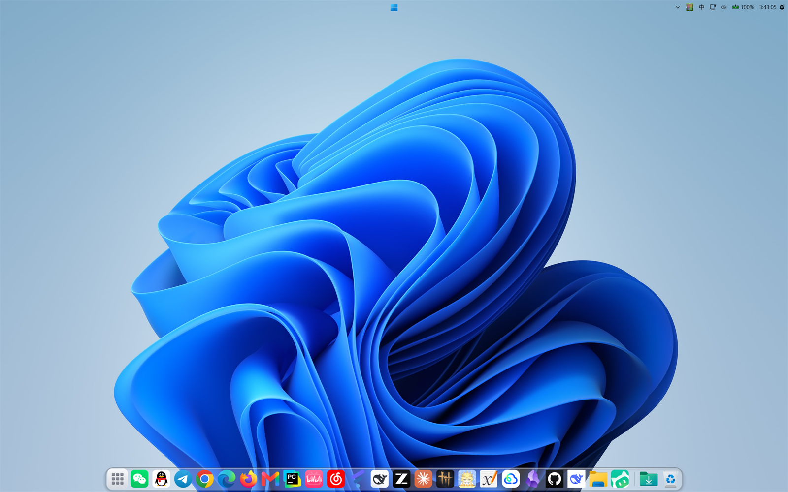
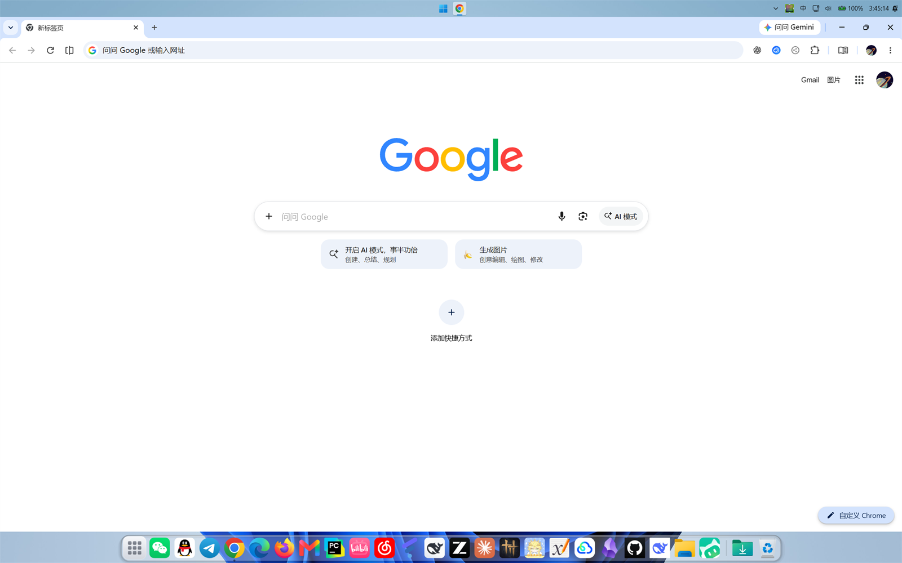

# MacDock · macOS 风格任务栏（Windows 11）




> **独立项目，不是任何项目的官方版本。**
> 起点代码来自 [**lupanostefano/Gravitone**](https://github.com/lupanostefano/Gravitone)（MIT License，© 2026 Stefano Lupano），此后按自己的方向开发与维护。
> 与上游作者无关；问题请提到本仓库，不要打扰上游。

屏幕底部是一条 macOS 风格的 **Dock**（波浪放大、运行提示、文件夹栈、回收站）+ 全屏**启动台**；
屏幕顶部交还 **Windows 原生任务栏**（托盘、输入法、时钟都在它上面）。

---

## 相对上游做了什么

| 分类 | 改动 |
| --- | --- |
| 中文化 | 全量简体中文文案（63 条）；字体栈改用 `Segoe UI Variable + 微软雅黑 UI`，并统一 `TextFormattingMode=Display` + 灰度抗锯齿，150% 缩放下小字不再发虚 |
| 启动台（新增） | 扫描开始菜单 → 过滤发行版/噪声/系统工具（197 → 77 个应用）；拼音首字母 + 子序列搜索；分页 + 滚动翻页；**扫描结果缓存**（打开 ~0.4s）；`F4` 开关 |
| 输入法 | 菜单栏新增"中/英"指示器（`ImmGetConversionStatus`），左键切换、右键选择输入法 |
| 真透明 | 放弃 DWM 系统背景材料与 accent 模糊（在这台机器上会渲染成不透明灰板），Dock 板 / 菜单栏改成逐像素 alpha 的分层窗口 |
| 启动体验 | 两段式启动（先 `--hide-taskbar` 收掉原生任务栏，再起 Dock）；开机时 Dock 从屏幕底边**上滑 380ms**；可选开机预热（SYSTEM 计划任务预读 ~45 个 DLL） |
| 全屏处理 | 只有"盖住整块屏"的窗口才收起 Dock/菜单栏；排除最大化窗口、Alt+Tab 任务视图、OEM 弹窗（联想电脑管家等） |
| 性能 | 空闲 CPU 46% → 0.8%；私有内存 622MB → ~120MB；去掉 genie 动画与全部软件光栅化效果；图标解码 256→176px |
| 行为修正 | 单实例程序（开始即退出的情况）不再误提权；托盘程序（任务管理器/播放器）用 `SC_RESTORE` 叫回窗口；右键菜单自绘 + 低级鼠标钩子关闭 |
| 部署 | 框架依赖发布 + `MacDock.vbs` 设 `DOTNET_ROOT` 的静默启动器；自启动走 Run 键 + 登录计划任务；一键 `uninstall.ps1` 还原任务栏 |

## 构建

需要 .NET 9 SDK（Windows）。

```powershell
# 在仓库根目录执行
dotnet build MacDock.csproj -c Release
dotnet publish MacDock.csproj -c Release --self-contained false -o dist\MacDock
```

> ⚠️ **不要用 self-contained / ReadyToRun 发布**：实测会导致 ManagedShell 托盘初始化失败
> （`Notification area: failed to start`，托盘图标全丢）。框架依赖 + VBS 启动器是验证过的组合。

## 安装 / 卸载

```powershell
# 安装（复制到 %LOCALAPPDATA%\MacDock、写启动器、设自启、接管任务栏）
powershell -ExecutionPolicy Bypass -File .\tools\install.ps1

# 卸载并还原 Windows 任务栏
powershell -ExecutionPolicy Bypass -File .\tools\uninstall.ps1 -RestoreTaskbar
```

紧急还原（不进 UI）：

```powershell
%LOCALAPPDATA%\MacDock\app\MacDock.exe --restore-taskbar
```

## 快捷键

| 按键 | 作用 |
| --- | --- |
| `F4` | 打开/关闭启动台（可在 `%APPDATA%\MacDock\config.json` 的 `LaunchpadKey` 改虚拟键码） |
| `Ctrl+Alt+Shift+B` | 临时显示/隐藏 Windows 原生任务栏（`TaskbarHotkey`） |
| `Shift + 点菜单栏徽标` | 原生开始菜单（左键默认是启动台，右键是 Win+X） |

## 已知限制

- 全屏大小的分层窗口在部分 Windows 版本上没有逐像素合成，因此**启动台用的是接近实底的配色**（macOS "降低透明度"观感），Dock 与菜单栏是真半透明。
- Copilot 键由厂商/系统在更底层处理，低级键盘钩子收不到，无法绑定。
- 开机首帧仍有 ~1.3–5.7s 的 .NET/WPF 冷装载（加开机预热任务可压到 ~1.3s，但抢不抢得到磁盘看运气）。

## 许可

MIT。起点代码的版权归 **Stefano Lupano**；本项目新增与修改部分的版权归 **sujiu0616-art**。
详见 [`LICENSE`](LICENSE) 与 [`NOTICE.md`](NOTICE.md)。
第三方组件（ManagedShell 等）见 [`THIRD-PARTY-NOTICES.md`](THIRD-PARTY-NOTICES.md)。
